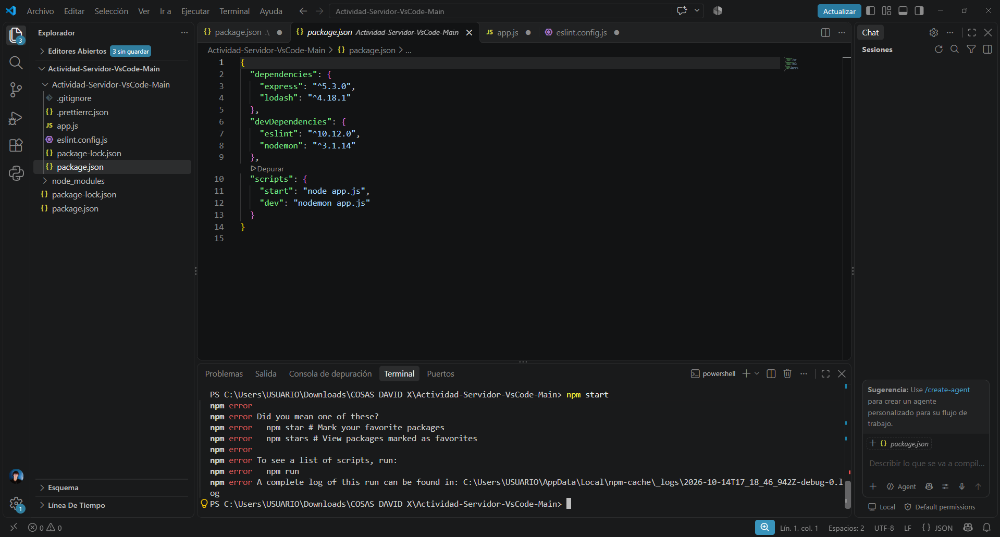
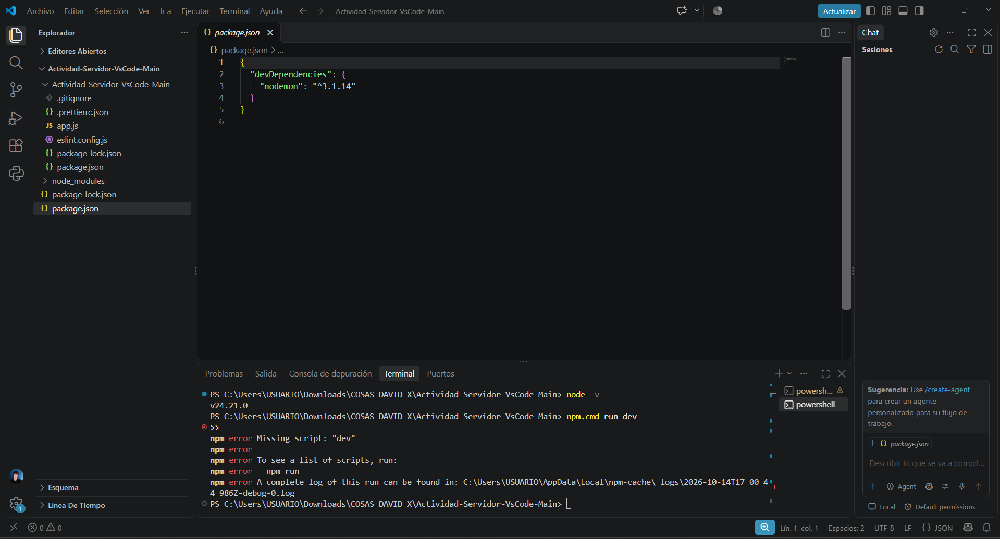
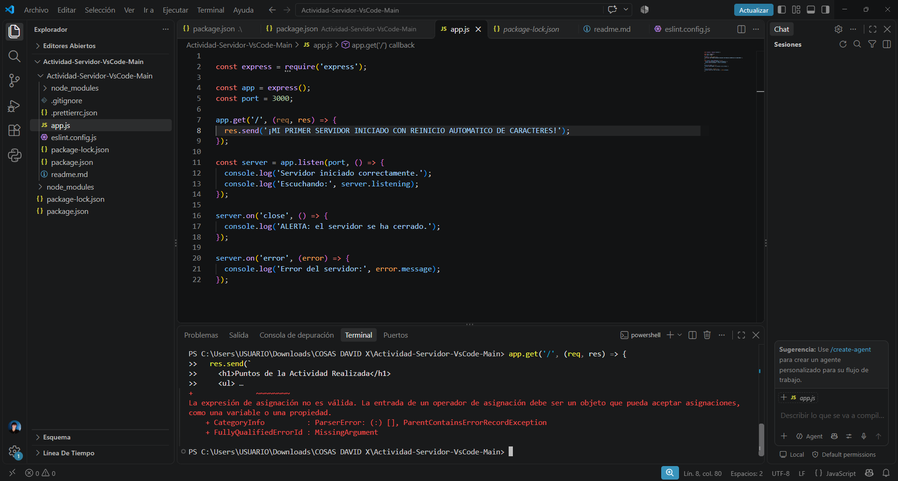
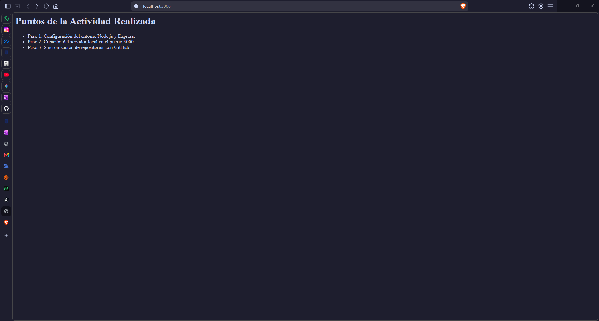
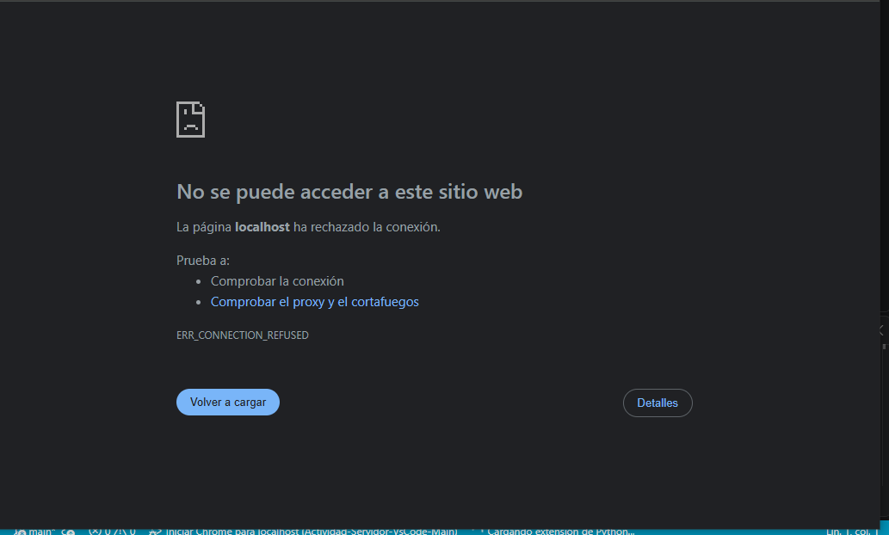

# Reporte de Actividad: Creación y Configuración del Servidor Web Local

## 1. Instalación de Herramientas y Entorno de Desarrollo

* **Extensión en VS Code:** Se instaló la extensión **Dadroit JSON Generator** para facilitar la visualización y estructuración de archivos de datos JSON en la app de VS CODE en el apartado de extensiones.
* **Instalación de Node.js:** Se descargó e instaló la versión LTS de **Node.js** desde el sitio web oficial (`nodejs.org`) para permitir la ejecución de código JavaScript en el entorno local.

---

## 2. Configuración de Permisos en Windows PowerShell

Para autorizar la ejecución de scripts de Node.js y paquetes de `npm` en el sistema, tube que realizar los siguientes pasos:

1. Se ejecutó **Windows PowerShell** como Administrador.

1. Se ingresó el comando para ajustar la directiva de ejecución del usuario actual:

## Codigo en la PowerShell

Set-ExecutionPolicy -Scope CurrentUser -ExecutionPolicy RemoteSigned

luego se confirmo la accion presionando la tecla S (SI).

y nuevamente me dirigi a VS CODE y me dirigi a <http://localhost:3000/> y hay pude corroborar que la pagina web estaba funcionando correctamente a tiempo real gracias a las extenciones y herramientas que se istalaron y se configuraron anteriormente.

## subir el trabajo a un repositorio de GitHub

Despues de eso cree un nuevo repositorio en GitHub para poder subir la actividad en ese sitio, y todo mundo (el profesor) pueda ver los resultados de como quedaron mi actividad.

## Errorres comunes que se me presentarion al realizar la actividad

## Error No 1

* En esta parte de la acttividad se me presento un problema con el archivo (package.json) el cual consistia en que el codigo tenia unos pequeños errores de ortografia en dode se codifica codigo.

## Error No 2

* En esta parte de la actividad se me presento un error mas el cual era un error el cual al poner el codigo:

app.get('/', (req, res) => {
  res.send('¡MI PRIMER SERVIDOR INICIADO CON REINICIO AUTOMATICO DE CARACTERES!');
});

const server = app.listen(port, () => {
  console.log('Servidor iniciado correctamente.');
  console.log('Escuchando:', server.listening);
});

server.on('close', () => {
  console.log('ALERTA: el servidor se ha cerrado.');
});

server.on('error', (error) => {
  console.log('Error del servidor:', error.message);
});

* Este era un error el cual se me presento entre la consola y el servidor ya que ninguno de los 2 se lograba conectar entre si para poder ver los resultados de la pagina web en: <http://localhost:3000/> para poder ver los cambios a tiempo real

## PAGINA WEB FUNCIONANDO

* De esta manera fue como finalmente se logro ver la pagina web <http://localhost:3000/> con todo el sitema de entrelazamiento de la consola y el servidor y errores de codigo corregidos para que funcionara correctamente.

PAGINA WEB CON FALLOS:

* De esta manera salia la pagina web <http://localhost:3000/> presentando un error por algo mal escrito en la terminal de VS CODE o por el entrelazamiento de la consola y el servidor.
