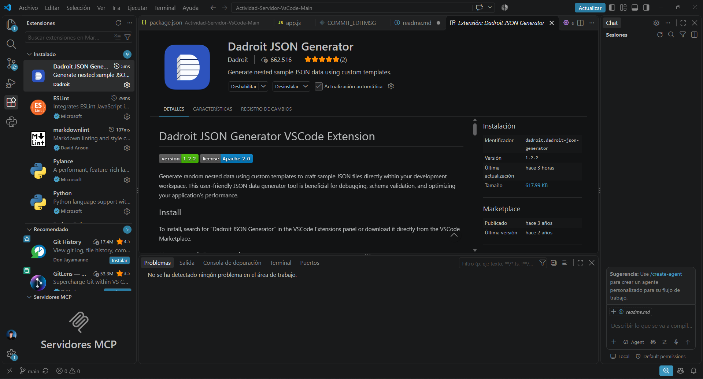
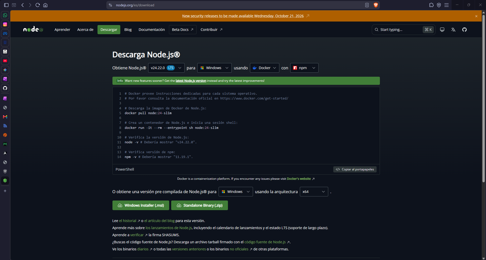
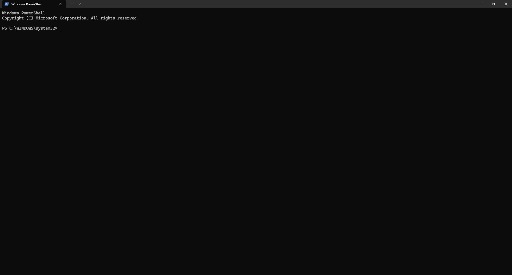
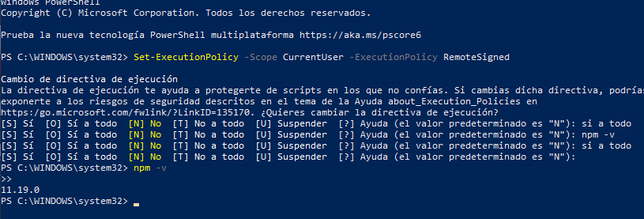
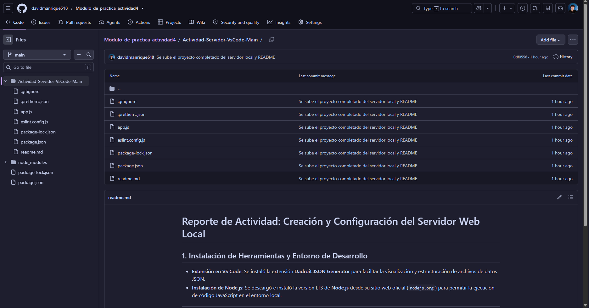

# Reporte de Actividad: Creación y Configuración del Servidor Web Local

## 1. Instalación de Herramientas y Entorno de Desarrollo

* **Extensión en VS Code:** Se instaló la extensión **Dadroit JSON Generator** para facilitar la visualización y estructuración de archivos de datos JSON en la app de VS CODE en el apartado de extensiones.
* **Instalación de Node.js:** Se descargó e instaló la versión LTS de **Node.js** desde el sitio web oficial (`nodejs.org`) para permitir la ejecución de código JavaScript en el entorno local.

---

## 2. Configuración de Permisos en Windows PowerShell

Para autorizar la ejecución de scripts de Node.js y paquetes de `npm` en el sistema, tube que realizar los siguientes pasos:

1. Se ejecutó **Windows PowerShell** como Administrador.

1. Se ingresó el comando para ajustar la directiva de ejecución del usuario actual:

## Codigo en la PowerShell

Set-ExecutionPolicy -Scope CurrentUser -ExecutionPolicy RemoteSigned

luego se confirmo la accion presionando la tecla S (SI).

y nuevamente me dirigi a VS CODE y me dirigi a <http://localhost:3000/> y hay pude corroborar que la pagina web estaba funcionando correctamente a tiempo real gracias a las extenciones y herramientas que se istalaron y se configuraron anteriormente.

## subir el trabajo a un repositorio de GitHub

Despues de eso cree un nuevo repositorio en GitHub para poder subir la actividad en ese sitio, y todo mundo (el profesor) pueda ver los resultados de como quedaron mi actividad.
